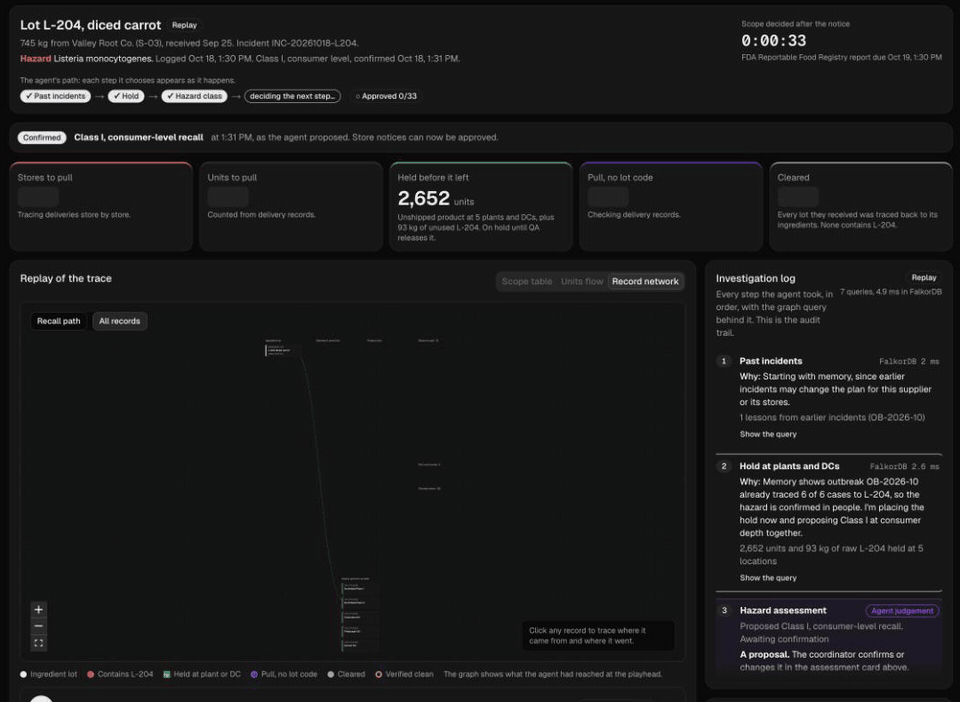

# Recall Tracer

[](https://recall-tracer.onrender.com/incident/L-204?replay=1)

**33 of 71 stores pulled instead of all 71. 2,256 units instead of 7,672. 38 stores cleared, each one proven by the records.** Above: a real agent run replayed at 2× speed. [Open the replay](https://recall-tracer.onrender.com/incident/L-204?replay=1).

When a supplier reports a contaminated ingredient lot, most food companies can't say which stores got it, so they recall everything. Recall Tracer is an agent that works the incident the way a recall coordinator does, on a FalkorDB graph of lots, batches, rework, inventory and deliveries: it assesses the hazard, holds what hasn't left the plant, follows the lot to every store with the path that proves it, clears the stores whose records are clean, widens the recall where records are missing, and drafts notices for a human to confirm and approve.

Built for [Graph Hacks: Context for AI Agents](https://www.wemakedevs.org/hackathons/falkordb), Track 01 (agents that act on connected data) and Track 02 (agent memory and coordination).

**Live:** https://recall-tracer.onrender.com (free tier: the first load can take a minute to wake up)

## Five minutes for judges

1. Open the [recorded run of lot L-204](https://recall-tracer.onrender.com/incident/L-204?replay=1). It replays a real agent run with its real timing: 11 graph tools, 9 turns, each step with its Cypher and FalkorDB's own execution time. Drag the timeline or click a step.
2. Click any store in the table or the record network. The evidence drawer shows the chain of records that decided it, or the backward trace that cleared it.
3. Open the [supplier notice](https://recall-tracer.onrender.com/notice), enter `L-204`, pick Listeria and press **Open incident** for a live run (about 50 s; capped per visitor). The agent asks you about the two stores with missing lot codes.
4. Open [Find the source](https://recall-tracer.onrender.com/outbreak) and press **Find the source**: the outbreak agent ranks ingredient lots by the illness cases they explain, and leaves a lesson the incident agent reads on its next run (Track 02).
5. [History](https://recall-tracer.onrender.com/history) lists every incident and what it saved for the next one.

Everything on screen comes from FalkorDB; the model never decides which store is affected. Code map: Cypher in [`src/graph/queries.ts`](src/graph/queries.ts), tool handlers in [`src/tools/index.ts`](src/tools/index.ts), the agent in [`src/agent/`](src/agent/), the MCP server in [`src/mcp/`](src/mcp/).

## How we meet the brief

**Track 01: Agents that act on connected data.**

| Focus point | What the agent does | Where | Evidence |
|---|---|---|---|
| Multi-hop reasoning | Follows L-204 through up to 8 hops: lot → batch → rework (B-03 leftovers into B-09) → product lot → store. Then walks the other way to prove the 38 cleared stores are clean | `trace_forward`, `trace_backward` in [`src/graph/queries.ts`](src/graph/queries.ts) | 31 stores reached, rework found, decoy lot L-205 not; asserted in `tests/tools.test.ts` |
| Graph queries and algorithms as tools | `rank_chokepoints` runs FalkorDB's `algo.betweenness` on the lineage subgraph and names the batch most of the spread flows through | `CHOKEPOINTS` in `src/graph/queries.ts` | B-03 ranks first (Batch, 16 stores downstream), the same on every run (fixed sampling seed); asserted in tests |
| Tool selection through MCP | 13 tools on our own MCP server (stdio and Streamable HTTP at `/mcp`). Each agent gets the subset it needs: the outbreak agent only 2 read-only tools | `src/mcp/server.ts`, `makeOutbreakAgent` / `makeIncidentAgent` in [`src/agent/ai-agent.ts`](src/agent/ai-agent.ts) | The live trace shows each tool call with its input and Cypher |
| Actions based on what the graph shows | Writes the incident and the proposed class, marks 93 kg and 2,652 units held, widens the recall to 2 stores with missing lot codes, drafts 33 notices for approval | `place_hold`, `minimal_recall`, `draft_recall_notice` | 33 of 71 stores, 2,256 units instead of 7,672 |
| Explainable results | Every store has the record path that proves its decision. The investigation log shows each step's Cypher and FalkorDB time. The final JSON is built from tool output, not retyped by the model | Evidence drawer, investigation log, `toResult` in `src/agent/run.ts` | Replay any step at `/incident/L-204#step-6` |
| The agent plans its own path | A guided plan, not a script: the prompt gives a goal and a set of checks with the rule for each, and the agent picks the next one from what the last returned, writing one sentence on why before each call. When there are stores with no lot code it stops and asks the coordinator (`ask_coordinator`: pull or flag, with buttons in the trace; no reply in 90 s or no one watching means the default, pull) | `src/agent/prompt.md`, `src/agent/questions.ts` | Recorded runs in `demo/`: L-204 (gaps, coordinator asked), L-205 (memory flags repeat gap stores, checked early), L-143 (one batch, so no chokepoint ranking; no gaps, so no question), L-108 (never used: hold only, scope of zero). Links on `/incident` |

**Track 02: Agent memory and coordination.**

| Focus point | What the agents do | Where | Evidence |
|---|---|---|---|
| Episodic memory | Each incident is an `Incident` node with its hazard, proposed and confirmed class and timestamps. At the end of a run the agent saves 2 to 4 lessons as `Memory` nodes linked to the supplier, gap stores and chokepoint batch | `record_lessons`, `MEMORY_WRITE` | After an L-204 run the graph holds lessons about S-03, B-03, ST-013 and ST-021 |
| Memory across sessions | The first step of every incident is `recall_memory`. It reads lessons from earlier incidents about the same supplier or the stores the new lot reaches, and skips the lot's own | `recall_memory`, `MEMORY_READ` | Opening L-205 (same supplier) brought back 3 lessons from OB-2026-10 and L-204, and the agent flagged ST-013 and ST-021 as repeat gap stores |
| Memory that updates | Rerunning an incident replaces that incident's lessons instead of piling up duplicates | `MEMORY_CLEAR` then `MEMORY_WRITE` | Round-trip test in `tests/tools.test.ts` |
| Handoffs between agents | The outbreak agent finds the source lot from illness cases and writes a lesson about its supplier. The incident agent picks it up through `recall_memory` when that supplier's lot is opened. The handoff goes through the graph, so it survives restarts | `runOutbreak` in `src/agent/ai-agent.ts` | The L-204 hazard assessment cites outbreak OB-2026-10 |
| Shared state | The outbreak agent, the incident agent, the chat agent and the dashboard all read and write one FalkorDB graph. The dashboard never calls Claude, so it always agrees with what the agents wrote | `GET /incident/:lot` | Store statuses come from `minimal_recall` |

Not covered: separate memory per user or tenant (there is one company), and load testing of concurrent writes.

**Demo, seeded data, lot L-204:**

| | |
|---|---|
| Hazard | Listeria monocytogenes in diced carrot; the agent proposes Class I, consumer-level, the coordinator confirms |
| Held | 93 kg of unused L-204 at the plant and 2,652 unshipped units at 2 plants and 3 DCs, marked held in the graph |
| Reached | 4 batches (one blends L-204 with clean L-117; B-09 reuses leftovers of B-03), 7 product lots, 31 stores |
| Gaps | 2 stores got Garden Vegetable Stew with no lot code on the delivery record, so they pull it too |
| Cleared | 38 stores got the same products, but only from lots that don't trace to L-204, verified by a backward trace |
| Result | Blanket recall 71 stores vs targeted 33; 2,256 units to pull instead of 7,672; 33 draft notices; public notice facts; FDA-style shipping CSV |

## How it works

```text
Next.js app (web/) ──rewrites──> Hono API ──> agent (Claude) ──MCP stdio──> MCP server ──> tools ──Cypher──> FalkorDB
                  └── /mcp (Streamable HTTP) ──> same tools, for any MCP client
```

- **The graph decides; Claude doesn't.** Which stores are affected, gaps or safe comes only from Cypher results. Claude picks the tools, makes the gap decision, explains the result and writes the notice reasons. The API's final JSON is built from the `minimal_recall` tool output, not retyped by the model.
- **One judgement is the agent's, and it is a proposal.** From the hazard on the supplier notice, the agent proposes the recall class (I, II, III) and depth (consumer, retail, wholesale) with a rationale. It is written to the `Incident` node and the coordinator confirms or changes it before any notice can be approved.
- **The graph is the audit trail.** The incident, the hazard, the proposed and confirmed class, and the hold on inventory are all written to FalkorDB with timestamps.
- **Tools go through MCP.** The agent starts the project's own MCP server (`src/mcp/server.ts`) as a stdio child process, lists its tools and hands them to Claude. The same tools are also served over Streamable HTTP at `/mcp` on the API port (Vercel's `mcp-handler`), so any MCP client can call them. Both transports share one tool registration. The stdio server works in Claude Code or Claude Desktop (`.mcp.json` is included).
- **Gap detection is the agent's decision.** `minimal_recall` takes `add_gap_stores`. The agent adds gap stores (policy: missing product is worse than pulling a few extra units); `false` only flags them.
- **Humans approve.** Notices are `Notice` nodes in the graph with status `pending_approval`, each linked to its store. Approving changes the node's status; nothing is ever sent.

## Graph model

Graph name `recall`. All ids are strings and dates are ISO strings.

| Node | Properties |
|---|---|
| `Supplier` | `id`, `name` |
| `Lot` | `code` (e.g. L-204), `ingredient`, `received_at`, `received_kg`, `supplier_id` |
| `Site` | `id` (plant, e.g. PL-1), `name`, `city`, `region` |
| `DC` | `id` (distribution centre), `name`, `city`, `region` |
| `Batch` | `id` (e.g. B-03), `produced_at`, `site`, `site_id` |
| `Product` | `sku`, `name`, `upc` |
| `ProductLot` | `id` (traceability lot code, e.g. TLC-03A), `sku`, `produced_at`, `best_by` |
| `Store` | `id`, `name`, `city`, `region` |
| `Incident` | `id`, `lot`, `hazard`, `reported_at`, proposed `class`, `depth`, `rationale`, `classified_at`, `confirmed_class`, `confirmed_depth`, `confirmed_at` |
| `Memory` | `lot` (the incident lot or outbreak cluster that wrote it), `fact`, `at` |
| `Notice` | `lot`, `store`, `reason`, `status` (`pending_approval` or `approved`), `drafted_at`, `text` |

| Edge | Properties | Meaning |
|---|---|---|
| `(Supplier)-[:SUPPLIED]->(Lot)` | | Who sent the lot |
| `(Lot)-[:USED_IN]->(Batch)` | `qty_kg` | Lot blended into a batch |
| `(Lot)-[:STORED_AT]->(Site)` | `qty_kg`, `held_for`, `held_at` | What is left of the lot in the plant store room |
| `(ProductLot)-[:HELD_AT]->(Site or DC)` | `units`, `held_for`, `held_at` | Unshipped product (units made = shipped + held) |
| `(Incident)-[:CONCERNS]->(Lot)` | | The open incident for a lot |
| `(Memory)-[:ABOUT]->(Supplier, Store, Batch, Site or DC)` | | What a lesson is about |
| `(Notice)-[:TO]->(Store)` | | The store a draft notice is for |
| `(Batch)-[:REWORKED_INTO]->(Batch)` | `qty_kg` | Leftovers reused in a later batch |
| `(Batch)-[:PRODUCED]->(ProductLot)` | `units` | Batch split into product lots |
| `(ProductLot)-[:OF]->(Product)` | | Which SKU |
| `(ProductLot)-[:SHIPPED_TO]->(Store)` | `units`, `shipped_at` | Shipment with the lot code recorded |
| `(Product)-[:SHIPPED_UNTRACKED]->(Store)` | `units`, `shipped_at` | Shipment where the lot code wasn't recorded (a gap) |

There are indexes on `Lot.code`, `Batch.id`, `ProductLot.id`, `Product.sku`, `Store.id`, `Supplier.id`, `Site.id`, `DC.id`, `Incident.lot` and `Notice.lot`. Edges only point forward in time, so the graph has no cycles and bounded variable-length matches are safe.

## The dashboard

The page is built for the manufacturer's recall coordinator in the first hour of an incident, and reads top to bottom in the order they work.

- **Supplier notice**: lot code and hazard. Opening the incident writes an `Incident` node and starts a live 24-hour clock (FDA Reportable Food Registry report, FSMA 204 records request). When the run finishes, the header says how long after the notice the scope was decided.
- **Hazard assessment**: the agent's proposed class and depth with its rationale. The coordinator confirms, or changes class or depth and confirms. Nothing can be approved before this.
- **Headline numbers**: stores that must pull product (33 of 71, one tick per store); units to pull from stores vs a blanket recall; units and kilograms held before they left; stores that can't be cleared; stores cleared by the records. Each tile says in one line what the number means. The store tiles open the store table filtered to those stores. The "Can't be cleared" tile can preview the flag-only policy (31 of 71) and switch back to the agent's decision.
- **What left the plant**: a plain-language paragraph of the lineage, then three views. The *scope table* has one row per affected product lot: product and UPC, where and when it was made, how it came to contain the lot (including rework), best-by date, units made, shipped (and to how many stores) and on hold. *Units flow* is a Sankey of units from the lot to states, with a hatched band for deliveries with no lot code. *Record network* is every record as a node.
- **Live record network**: while the agent works, the network lights up as the agent reaches each record: the lot, then the plants and DCs put on hold, then the spread hop by hop (batches, rework, product lots, stores) with moving dashes, then the stores with missing records, the cleared stores, and the backward check.
- **Replay the trace**: plays a run back on the record network with a timeline under it. Each agent step is a marker at the time it finished (judgement steps in their own colour); drag the playhead or click a marker to see the graph, the investigation log and the dashboard exactly as they were at that step. Play, pause, restart, 0.5× to 4×, arrow keys step, space plays. The link carries the step (`/incident/L-204#step-6`), so it opens at that moment; `/incident/L-204?replay=1` (linked from the Incident tab) plays the recorded run from the start. It plays the run you just watched with its real timing; otherwise the server's recording of the run (`GET /recall/replay?lot=L-204&format=json`: the curated `demo/run-L-204.json` first, then the latest live run), which needs no API key; otherwise the saved run with estimated timing. The empty dashboard offers the recorded run too.
- **Where it went**: stores by state as stacked bars (pull, no record, cleared). Click a state to filter the table.
- **Exposure**: delivery dates, time on shelves, best-by range, and units delivered per day.
- **Public notice facts** (consumer-level recalls): products, UPCs, lot codes on pack, best-by dates, chains and states, read from the graph, with a button that copies them as text for the press release.
- **Store decisions**: all 71 stores with the decision (Pull product, Pull with no record, Cleared), what they received, units to pull, last delivery and notice status. Filter and search.
- **Evidence drawer**: click a store (in the table, the network or the notices). A side panel opens with one plain sentence saying why, then the chain of records with quantities and dates (lot → batch → rework → product lot → delivery), the missing record for a gap store, or each lot traced back to its ingredients for a cleared store. Escape closes it and returns focus to what opened it.
- **Investigation log**: streams live. Each agent step has a plain title (Hazard assessment, Hold at plants and DCs, Forward trace, Delivery record check, Scope decision, Backward check on cleared stores, Store notices drafted), the agent's short note, the result in one line, FalkorDB's own execution time for its queries, and the tool name with its input and Cypher. The two judgement steps (hazard assessment and scope decision) are marked as agent judgement with the policy they applied. The header totals the queries and FalkorDB time for the run. If the run fails, the error comes with a Retry button. The agent's summary closes it.
- **Store notices**: an approval queue grouped by state, enabled once the class is confirmed, plus the FDA CSV export.

All the dashboard data comes from `GET /incident/:lot`, which reads the graph without calling Claude. Store statuses come from `minimal_recall`, so the dashboard and the agent always agree.

## Tools and their Cypher

All Cypher is in [`src/graph/queries.ts`](src/graph/queries.ts) and the handlers are in [`src/tools/index.ts`](src/tools/index.ts).

**`propose_classification(lot, class, depth, rationale)`** records the agent's hazard assessment on the `Incident` node. It is a proposal; `POST /incident/:lot/confirm` records the coordinator's decision.

```cypher
MERGE (i:Incident {lot: $lot})
ON CREATE SET i.id = $id, i.reported_at = $at, i.hazard = 'not recorded'
SET i.class = $class, i.depth = $depth, i.rationale = $rationale, i.classified_at = $at
RETURN i.id AS id, i.hazard AS hazard
```

**`place_hold(lot)`** finds what has not left the company and marks it held: the unused remainder of the lot at the plant, and every unshipped unit of affected product at plants and DCs.

```cypher
MATCH (:Lot {code: $lot})-[:USED_IN|REWORKED_INTO|PRODUCED*1..6]->(pl:ProductLot)-[h:HELD_AT]->(loc)
WITH DISTINCT pl, h, loc
MATCH (pl)-[:OF]->(p:Product)
RETURN pl.id AS product_lot, p.name AS product, labels(loc)[0] AS kind, loc.id AS id, loc.name AS name,
       loc.city AS city, loc.region AS region, h.units AS units
```

**`trace_forward(lot)`** returns every store reached, with the full path. The handler groups by store, collects the batches and product lots on the paths, and sums units per shipment.

```cypher
MATCH path = (l:Lot {code: $lot})-[:USED_IN|REWORKED_INTO|PRODUCED|SHIPPED_TO*1..8]->(st:Store)
RETURN st.id AS store,
       [n IN nodes(path) | coalesce(n.code, n.id)] AS path,
       [n IN nodes(path) | labels(n)[0]] AS kinds,
       last(relationships(path)).units AS units
```

**`coverage_gaps(lot)`** returns stores that got an affected SKU through a shipment with no lot code. The handler drops stores already found by `trace_forward` and writes the reason.

```cypher
MATCH (:Lot {code: $lot})-[:USED_IN|REWORKED_INTO|PRODUCED*1..6]->(pl:ProductLot)
WITH collect(DISTINCT pl.sku) AS skus
MATCH (p:Product)-[u:SHIPPED_UNTRACKED]->(st:Store)
WHERE p.sku IN skus
RETURN st.id AS store, p.sku AS sku, p.name AS product, u.units AS units, u.shipped_at AS shipped_at
```

**`unaffected_stores(lot)`** returns every store that got an affected SKU, minus the affected and gap stores. Each store lists the lots it received with `reachable_from_bad_lot: false`; the handler fails loudly if a safe store holds an affected lot.

```cypher
MATCH (:Lot {code: $lot})-[:USED_IN|REWORKED_INTO|PRODUCED*1..6]->(pl:ProductLot)
WITH collect(DISTINCT pl.sku) AS skus
MATCH (pl2:ProductLot)-[:SHIPPED_TO]->(st:Store)
WHERE pl2.sku IN skus
RETURN st.id AS store, collect(DISTINCT pl2.id) AS received_lots
```

**`minimal_recall(lot, add_gap_stores = true)`** combines the three tools above: `recall_stores` (affected plus gap stores), `units_to_pull`, and `blanket`, `targeted` and `safe` counts. Blanket means every store that received any affected SKU.

**`trace_backward(product_lots, lot?)`** walks product lots back to every ingredient lot in them, including through rework. The agent uses it to verify the safe stores independently of `trace_forward`: none of the lots they hold may contain the bad lot.

```cypher
MATCH (l:Lot)-[:USED_IN]->(:Batch)-[:REWORKED_INTO*0..3]->(:Batch)-[:PRODUCED]->(pl:ProductLot)
WHERE pl.id IN $product_lots
RETURN pl.id AS product_lot, collect(DISTINCT l.code) AS ingredient_lots
```

**`rank_chokepoints(lot)`** runs betweenness centrality over the lineage graph and keeps the batches and product lots downstream of the lot. The top node is where one fix stops most of the spread. FalkorDB samples at random, so the seed is fixed to make the ranking repeatable.

```cypher
CALL algo.betweenness({nodeLabels: ['Lot', 'Batch', 'ProductLot', 'Store'], relationshipTypes: ['USED_IN', 'REWORKED_INTO', 'PRODUCED', 'SHIPPED_TO'], samplingSize: 1000, samplingSeed: 7})
YIELD node, score
WITH node, score WHERE score > 0 AND (node:Batch OR node:ProductLot)
MATCH (:Lot {code: $lot})-[:USED_IN|REWORKED_INTO|PRODUCED*1..6]->(node)
WITH DISTINCT node, score
OPTIONAL MATCH (node)-[:REWORKED_INTO|PRODUCED|SHIPPED_TO*1..6]->(st:Store)
RETURN labels(node)[0] AS kind, node.id AS id, score, count(DISTINCT st) AS stores
ORDER BY score DESC, id LIMIT 5
```

**`recall_memory(lot)`** returns the lot's supplier and the lessons other incidents left about that supplier or about the stores that got the same products.

```cypher
MATCH (s:Supplier)-[:SUPPLIED]->(l:Lot {code: $lot})
OPTIONAL MATCH (l)-[:USED_IN|REWORKED_INTO|PRODUCED*1..6]->(pl:ProductLot)
WITH s, collect(DISTINCT pl.sku) AS skus
WITH s, [(p:Product)-[:SHIPPED_UNTRACKED]->(a:Store) WHERE p.sku IN skus | a.id]
       + [(q:ProductLot)-[:SHIPPED_TO]->(b:Store) WHERE q.sku IN skus | b.id] AS stores
MATCH (m:Memory)-[:ABOUT]->(x)
WHERE m.lot <> $lot AND (x = s OR (x:Store AND x.id IN stores))
RETURN m.lot AS from_lot, m.at AS at, labels(x)[0] AS kind, x.id AS about, m.fact AS fact
ORDER BY at DESC, about LIMIT 20
```

**`record_lessons(lot, lessons[{about, fact}])`** deletes the lot's earlier lessons, then saves up to 8 new ones, each linked to one node. Ids that match nothing are dropped and reported back.

```cypher
UNWIND $lessons AS lesson
MATCH (x {id: lesson.about}) WHERE x:Supplier OR x:Store OR x:Batch OR x:Site OR x:DC
CREATE (m:Memory {lot: $lot, fact: lesson.fact, at: $at})-[:ABOUT]->(x)
RETURN labels(x)[0] AS kind, x.id AS about, m.fact AS fact
```

**`find_common_source(cluster)`** and **`case_path(lot, cases)`** are the outbreak agent's tools. They rank ingredient lots by how many illness cases they explain, and return each case's path from the lot to the store where the food was bought.

**`draft_recall_notice(lot, notices[{store, reason}])`** writes one `Notice` node per store with status `pending_approval`, linked to the store, replacing the lot's earlier drafts. It never sends anything. `POST /notices/approve` sets the status to `approved` on the same nodes, so the graph holds the whole approval trail.

```cypher
UNWIND $notices AS x
MATCH (st:Store {id: x.store})
CREATE (n:Notice {lot: $lot, store: x.store, reason: x.reason, status: 'pending_approval', drafted_at: $at, text: x.text})-[:TO]->(st)
RETURN count(n) AS n
```

**FDA export** (`GET /export/L-204.csv`) has one row per affected shipment, plus one row per gap shipment with an empty lot code. Columns follow the Shipping tab of the FDA's [sortable spreadsheet template](https://www.fda.gov/food/food-safety-modernization-act-fsma/fsma-final-rule-requirements-additional-traceability-records-certain-foods).

```cypher
MATCH (:Lot {code: $lot})-[:USED_IN|REWORKED_INTO*1..4]->(b:Batch)-[:PRODUCED]->(pl:ProductLot)-[s:SHIPPED_TO]->(st:Store),
      (pl)-[:OF]->(p:Product)
RETURN DISTINCT pl.id AS tlc, p.name AS product, s.units AS units, s.shipped_at AS shipped_at,
       st.id AS store, st.name AS store_name, st.city AS city, st.region AS region, b.site AS site
ORDER BY tlc, store
```

## Demo video

[`demo/recall-tracer-demo.mp4`](demo/recall-tracer-demo.mp4) is a captioned walkthrough of one live run, from the supplier notice to the CSV export.

## Run it with one command

Needs Docker and an Anthropic API key.

```bash
cp .env.example .env            # add ANTHROPIC_API_KEY
docker compose up --build       # FalkorDB + app; seeds the demo graph on start
```

Open http://localhost:3000 (set `APP_PORT` to use another port). Without an API key the dashboards, the graph views and the recorded run at `/incident/L-204?replay=1` still work; only live agent runs need the key. Live agent runs (incident, outbreak, chat) are capped so a public URL can't run up the Claude bill: `AGENT_RUNS_PER_IP_HOUR` (default 10) per visitor and `AGENT_RUNS_PER_DAY` (default 100) in total; over the cap the page points to the recorded run. Chat sends only the last 10 messages, each under 2,000 characters. The MCP endpoint is at `http://localhost:3000/api/mcp`. The same `Dockerfile` deploys to any container host. Point `FALKORDB_HOST`/`FALKORDB_PORT` at a FalkorDB instance (for example FalkorDB Cloud) and set `ANTHROPIC_API_KEY`.

## Run it for development

Needs Docker, Node 22+ and Bun.

```bash
docker run -d --name falkordb -p 6380:6379 -p 3001:3000 falkordb/falkordb:latest
bun install
cp .env.example .env          # add ANTHROPIC_API_KEY; FALKORDB_PORT=6380
bun run generate --seed 42 --reset
bun run test                    # 45 tests on their own graph (recall_test), no API calls; E2E=1 bun run test adds one live agent run
bun run dev                     # API on :8787, Next.js app on http://localhost:3000 (opens at /outbreak; /notice, /incident (asks for the lot), /history, agent chat at /agent; the API is proxied under /api)
```

Enter `L-204`, pick the hazard and press **Open incident**. FalkorDB Browser on http://localhost:3001 shows the raw graph. For production, run `bun run build`, then `bun run start` (API on :8787) and `cd web && bun run start` (`next start` on :3000). The Next.js app proxies the API paths to `RECALL_API` (default `http://localhost:8787`).

To use the tools from Claude Code in this folder, the included `.mcp.json` registers the `recall-tracer` MCP server over stdio.

The same 13 tools are also served over Streamable HTTP at `http://localhost:8787/mcp` (on a deployment, `<deployed URL>/api/mcp`). The API must be running (`bun run dev` or `bun run start`). Point an HTTP MCP client at it:

```json
{ "recall-tracer": { "url": "http://localhost:8787/mcp" } }
```

For Claude Code: `claude mcp add --transport http recall-tracer http://localhost:8787/mcp`

For clients that only speak stdio: `npx -y mcp-remote http://localhost:8787/mcp`

### API

| Method | Path | Does |
|---|---|---|
| POST | `/recall` | Body `{lot, hazard}`. Opens the incident, runs the agent and returns the recall decision as JSON. Returns 404 without calling Claude if the lot isn't in the graph |
| GET | `/recall/last` | The last decision, so a page reload doesn't rerun the agent |
| GET | `/recall/stream?lot=&hazard=` | Same, streaming each step as Server-Sent Events (`note`, `tool_start`, `tool_end`, `done`) |
| GET | `/incident/:lot` | Dashboard data straight from the graph: incident, hold, lineage with quantities, product lots with UPC and best-by, every store's deliveries, where each lot came from. Add `?gaps=flag` for flag-only mode |
| POST | `/incident/:lot/answer` | Body `{choice}`. The coordinator's answer to the agent's question during a live run; 409 if nothing is waiting |
| GET | `/incident/:lot/status` | The incident node and the hold only; polled while the agent runs |
| POST | `/incident/:lot/confirm` | Body `{class, depth}`. The coordinator's decision on the agent's proposal |
| GET | `/graph/:lot` | Cytoscape nodes and edges, each tagged with the agent step that reveals it and its hop count, for the live network |
| GET | `/notices` | Draft notices with their status |
| POST | `/notices/approve` | Body `{stores}`. Marks them `approved`; nothing is sent |
| GET | `/export/:lot.csv` | FDA-style shipping records |

## Data

`src/data/generate.ts` builds a seeded synthetic graph: 8 suppliers, 20 lots, 2 plants, 3 DCs, 15 batches, 10 products with UPCs, 29 product lots with best-by dates, 75 stores, 163 nodes and 427 edges. Units made always equal units shipped plus units still held. The planted cases (bad lot, blend, rework, decoy lot L-205, gap, untouched stores) are hard-coded and everything else is randomised by `seedrandom`, so the same seed always gives the same graph. All company, store and supplier names are fictional. The generator writes `data/expected.json`, and the tests assert against it.

## Tests

`tests/tools.test.ts` covers the spec's acceptance list:
- the same seed gives the same graph
- the trace finds exactly 4 batches, 7 product lots and 31 stores
- rework is traced and the decoy lot isn't
- there are exactly 2 gap stores
- 38 safe stores, none of them in the recall
- blanket 71, targeted 33, safe 38, and flag-only mode gives 31
- the backward trace independently finds only the 7 affected product lots containing L-204
- the hold finds the unused raw lot and the unshipped units, made = shipped + held for every product lot, and the hold is written to the graph
- an incident can be opened, classified by the agent and confirmed (or changed) by the coordinator; bad classes are rejected
- the dashboard's incident report agrees with the tools, store by store
- 33 drafts are written
- bad input gets a 400 and an unknown lot a 404, without calling Claude
- the CSV has one row per shipment plus the gap rows
- the graph data and the approval step work
- betweenness ranks B-03 first, the same on every run
- lessons round-trip: unknown ids are dropped, a rerun replaces earlier lessons, a lot from the same supplier sees them, an unrelated lot and the writing lot don't
- with `E2E=1`, `POST /recall` runs end to end in under 60 seconds, starting with memory and ending with lessons, every required check present in a valid order, each MCP call with a summary and its Cypher

## AI disclosure

This project was built with AI coding help (Claude Code, Claude Opus 5.5) during the event, Oct 15–18 2026: scaffolding, the generator, tool handlers, the MCP server, the agent loop, the UI and this README. The team reviewed the code and can explain every part of it. At runtime the agent uses Claude (`claude-opus-5-5`) through the Anthropic API.

## Limits

- Synthetic data only; there's no real company data.
- No login. Notices are never sent; approval only changes the status on the `Notice` node.
- No dilution or risk scoring: any path from the bad lot counts as affected.
- Units to pull are units delivered, not units still on the shelf; there is no sales data.
- The recall class is the firm's assessment. In the US the FDA assigns the final classification.
