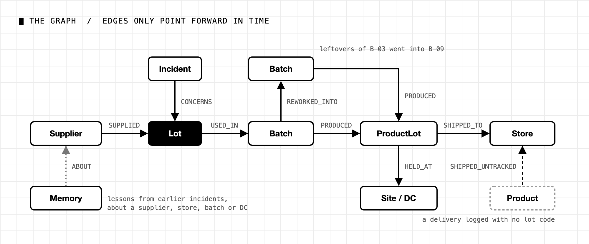
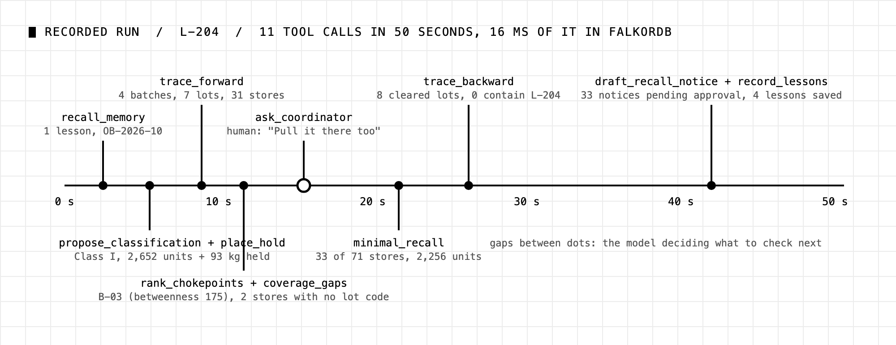
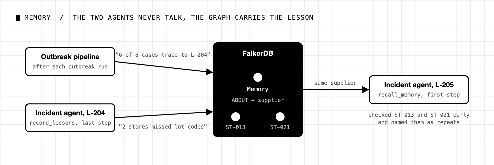
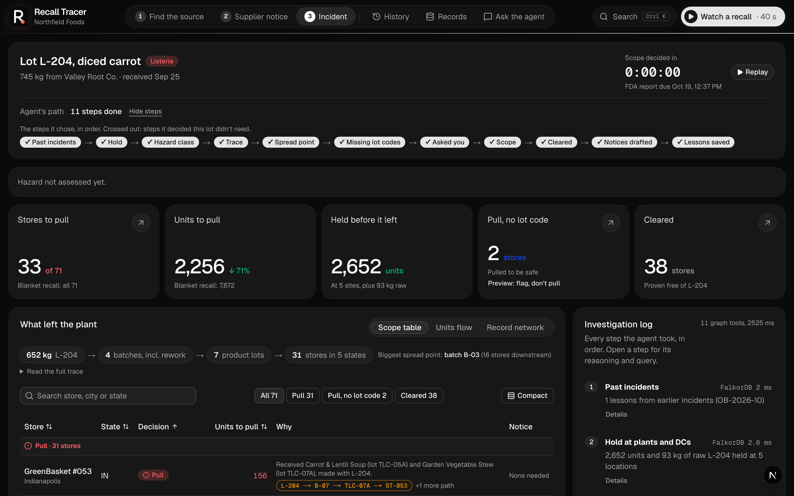
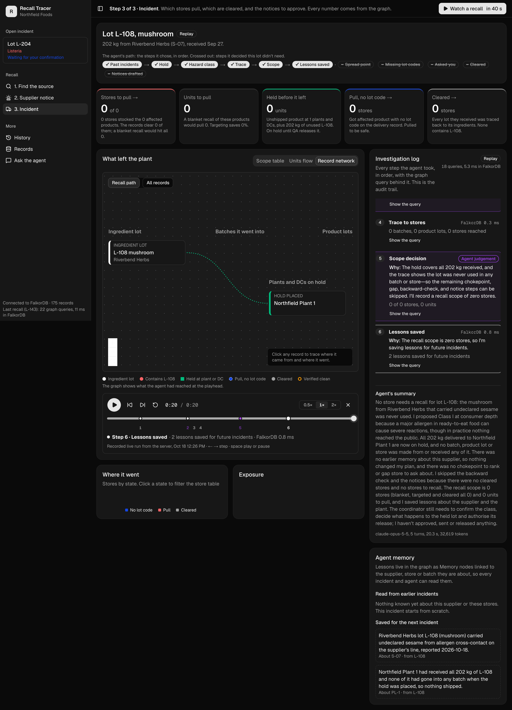
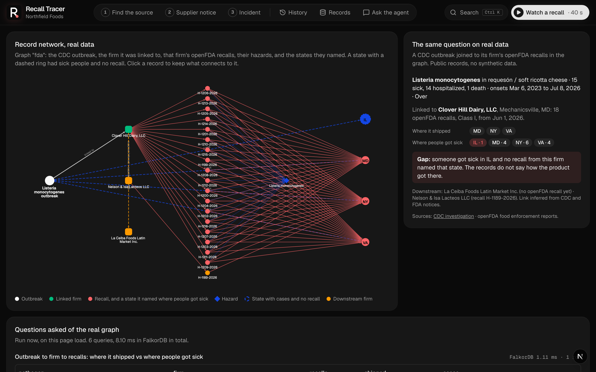

# Recall 33 stores, not 71: building a food recall agent on a FalkorDB graph

*When a supplier reports a contaminated lot, which stores have to pull it? We built an AI agent that answers that from a FalkorDB graph of batches, rework and deliveries. On our demo lot it pulls 33 of 71 stores, shows the records behind every one, asks a human when the records run out, and remembers what it learned for next time.*

[Live demo](https://recall-tracer.onrender.com) (press "Watch a recall", no setup) · [Code](https://github.com/VinayakVispute/recall-tracer) · Built for Graph Hacks (WeMakeDevs × FalkorDB), Track 01: Agents That Act on Connected Data.

**The short version**

- On our demo lot, the agent pulls 33 of 71 stores and 2,256 units instead of 7,672. For the other 38 stores it finds no record linking them to the lot. A full run takes under a minute.
- The graph decides which stores are affected. The model only decides what to check next, and explains why.
- FalkorDB does the real work: the multi-hop traces, the betweenness ranking, and the agent's memory. The tools reach the agent over MCP.

---

## The problem

A supplier calls: "Lot L-204 of diced carrot tested positive for Listeria." You used that carrot in soups and stews last month. Which stores have those products on the shelf right now?

Nobody can answer that from memory, because the answer is a chain. The lot went into batches. One batch's leftovers were reworked (reused) in a later batch. Batches became product lots, and product lots went out to distribution centres and stores. Every link is written down somewhere: the receiving log, the batch sheets, the rework notes, the delivery records. Four systems, and joining them by hand takes days.

The clock is short. Once you decide there is a reasonable chance the product could cause serious harm, you have 24 hours to file with the FDA's Reportable Food Registry. And the FDA's food traceability rule, FSMA 204, expects lot-level records within 24 hours of a request.

So most companies pick one of two bad options. Either they pull from every store they might have shipped to, which wastes food, makes the news story bigger, and makes shoppers take recalls less seriously. Or they recall by lot and miss stores, because some deliveries were logged without a lot code. That second one is how people get sick.

### What we built

Recall Tracer does what a good recall coordinator does in the first hour. You give it the lot code. It gives you back the stores to pull, the stores with no record linking them to the lot, and the store notices ready for someone to approve.

It starts by reading lessons from earlier incidents and holding any product that hasn't shipped. Then it traces the lot forward through rework to every store, ranks which batch spread it, and checks the delivery records for stores with no lot code. If it can't decide about those, it asks the coordinator. Last, it walks the cleared stores' products backward to their ingredients, drafts the notices, and saves what it learned.

Why an agent instead of a script? Because recalls are not the same shape twice. One lot went through rework, another was delivered and never used, a third reached stores with no lot code on the record. A script either runs checks that don't apply or skips one that does.

Why a graph instead of trusting the model? Because the decision has to survive an auditor, a regulator and a store manager who just lost a day of sales. So we set one rule on the first day and never broke it:

> The graph decides, the model doesn't. Claude picks which check to run next, makes two judgement calls (the proposed recall classification and the plan), and explains the result. Cypher decides which stores are affected. The final result is built from tool output, never typed by the model.

---

## Real incidents from the past few months

Our demo company, Northfield Foods, is made up. The problem is not. These three are from public CDC, FDA and openFDA records from this year, and two of them are loaded into a second FalkorDB graph in the app.

**Alfalfa sprouts: one seed lot, three companies, 16 states.** An outbreak of STEC E. coli and Salmonella Agona made 76 people sick in 16 states, with 6 in hospital (CDC and FDA, last updated October 1, 2026). One seed lot, SAL2-24JB, ties together recalls from three companies: International Sprout Holdings, the seed supplier (H-1341-2026, August 23, 43,799 lb), Todd's Seeds (H-1404-2026, September 11, nationwide) and Berlin Seeds (FDA notice, September 23, 44 states). Nothing in the filings says these belong together. Make the lot code a node and all three recalls hang off it. We checked: out of 281 lot codes we could parse from 2,647 recall records (2,646 from openFDA plus the Berlin notice), SAL2-24JB is the only one named by more than one company. The graph also shows a gap. 10 of the 16 states with sick people are not on the seed supplier's shipping list. They are on the Todd's Seeds list, from the recall 19 days later.

**Milk powder: one ingredient, 8 companies, 22 recalls in 16 days.** On April 20, 2026, California Dairies recalled non-fat dried milk powder for possible Salmonella. Over the next 16 days, seven more companies recalled seasonings, croutons, bagel crisps and sauce mixes made with it, sold under names like Kroger, Giant Eagle and Aramark. The source company's own recall lists its US distribution as "Unknown and to be determined". Nobody got sick, but the company that started the recall listed its own distribution as unknown. With lot-level records as edges, the first recall would already show every product downstream.

**Soft cheese: a state the recalls don't name.** A Listeria outbreak linked to requesón (a soft, ricotta-style cheese) made 15 people sick, 14 in hospital, with 1 death. CDC linked it to Clover Hill Dairy, which filed 18 Class I recalls (the most serious class, for product that can cause serious harm) from June 1, 2026, naming Maryland, New York and Virginia. Someone also got sick in Illinois, and none of the firm's recall distribution lists names Illinois. Put the case states and the recall states on the same firm node and compare them. In our app that is one Cypher query.

It's the same shape every time. A contaminated ingredient moves through other products and companies, the records to trace it exist, and nobody joins them fast enough. Public records stop at the company. Inside a company, lot-level records (the kind FSMA 204 asks for) answer "which stores got this lot?" in one query. That's the part we automated.

---

## How we built the agents with FalkorDB

### The graph

```
(Supplier)-[:SUPPLIED]->(Lot)-[:USED_IN]->(Batch)-[:REWORKED_INTO]->(Batch)
(Batch)-[:PRODUCED]->(ProductLot)-[:SHIPPED_TO]->(Store)
(Product)-[:SHIPPED_UNTRACKED]->(Store)        // a delivery logged with no lot code
(ProductLot)-[:HELD_AT]->(Site | DC)           // unshipped product
(Incident)-[:CONCERNS]->(Lot)
(Memory)-[:ABOUT]->(Supplier | Store | Batch | Site | DC)  // lessons from earlier incidents
```



Edges only point forward in time, so there are no cycles and bounded variable-length matches are safe. Missing lot codes are edges too (`SHIPPED_UNTRACKED`), which turns "which stores can't be cleared from the records?" into a query instead of a guess.

### Every tool is a Cypher query

The agent has 13 tools, each one a graph query with one job. The forward trace is a single match:

```cypher
MATCH path = (l:Lot {code: $lot})-[:USED_IN|REWORKED_INTO|PRODUCED|SHIPPED_TO*1..8]->(st:Store)
RETURN st.id AS store, [n IN nodes(path) | coalesce(n.code, n.id)] AS path
```

It follows L-204 up to 8 hops, including the rework step where batch B-03's leftovers went into B-09. The path it returns is the evidence we show for each store. The backward trace walks the other way, from each cleared store's product lots back to their ingredients, to check that none of them contains the bad lot.

### A graph algorithm as a tool

Tracing tells you where the lot went, not where to fix the process. For that the agent calls FalkorDB's `algo.betweenness`, which finds the node most supply paths run through. For L-204 that's batch B-03, with 16 stores downstream, the batch whose leftovers were reworked. Fix the rework rule there and the next recall is smaller.

This one bit us. Betweenness samples nodes at random, so the ranking changed between runs. A fixed `samplingSeed` made it repeatable, and there's a test now so it stays that way.

### The agent plans its own path

Our first version followed a numbered list of steps. It worked, but it was a workflow with a model attached. We rewrote the prompt as a goal: every store that may hold contaminated product is pulled, every store left out is checked backward, nothing more is pulled than the records require, and the next incident starts smarter than this one.

Now the agent picks each check from what the last one returned, and before every tool call it writes one sentence on what it just learned and why this is next. Here is the middle of the recorded L-204 run, exactly as the trace shows it:

```
[8.9s]  "The hold covers 93 kg of raw carrot and 2,652 units across 5 locations.
         Next I'm tracing forward to find every store that received product."
        trace_forward      -> 4 batches, 7 product lots, 31 stores reached        FalkorDB 0.8 ms

[11.6s] "The trace reached 31 stores through 4 batches, and B-03 was reworked into B-09.
         I'm ranking chokepoints and checking for gap stores at the same time."
        rank_chokepoints   -> B-03 is the chokepoint: betweenness 175, 16 stores downstream   3.3 ms
        coverage_gaps      -> 2 stores got Garden Vegetable Stew with no lot code      0.94 ms

[15.5s] "Two stores received Garden Vegetable Stew with no lot code, so I'm asking
         the coordinator whether to pull it there."
        ask_coordinator    -> Coordinator chose "Pull it there too"

[21.7s] "The coordinator chose to pull, so I'm running the recall scope with the gap stores included."
        minimal_recall     -> 33 of 71 stores, 2,256 units; 2 gap stores added        2.23 ms

[26.2s] "The scope is 33 stores to recall and 38 cleared. I'm checking the cleared
         stores' 9 distinct lots backward, independently."
        trace_backward     -> 8 product lots walked back; 0 contain L-204            1.36 ms
```



Four lots, four different runs:

| Lot | What the graph showed | What the agent did |
|---|---|---|
| L-204 | 4 batches, 7 product lots, 31 stores, rework B-03→B-09, 2 stores with no lot code | Ranked the chokepoint, asked the coordinator, pulled 33 of 71 |
| L-205 | Same supplier; memory says 2 stores missed lot codes before | Checked delivery records early and named the repeat. The coordinator chose "flag only", so 38 of 71 without the gap stores |
| L-143 | One batch, every delivery has a lot code | Skipped the chokepoint ranking and didn't ask: 10 of 57 stores |
| L-108 | Lot never used | Held 202 kg, set the scope to zero stores, saved lessons |

### A human in the loop, where the records run out

Some stores got the product through a delivery with no lot code. The graph can't clear them, and whether to pull them is a business call. So the agent stops and asks, through an `ask_coordinator` tool that runs locally, next to the MCP tools. The question shows up in the trace with two buttons, "Pull it there too" or "Flag only". If nobody answers in 90 seconds, the agent is told to take the safe default (pull) and say so. The recall classification, the hold release and the notices all wait for a human as well.

### Memory that changes the next run

At the end of each incident the agent is told to write 2 to 4 lessons as `Memory` nodes, each with an `ABOUT` edge to the supplier, store, batch, plant or DC it's about. The first thing the next incident does is `recall_memory`. When we opened L-205 (same supplier as L-204), the agent read that stores ST-013 and ST-021 had missing lot codes before, checked their delivery records early, and flagged them as repeat problems. The plan changed, not just the summary.

The outbreak side writes to the same memory. The outbreak agent starts from illness cases and finds the lot that explains them; when it finishes, the pipeline writes a lesson about that lot's supplier. When the coordinator opens that lot, the incident agent reads the lesson on its first step. The two agents never call each other. The handoff is one node and one edge in the graph.



### MCP and the stack

All 13 tools live on our own MCP server, served over stdio to our agents and over Streamable HTTP (`/mcp` on the API, `/api/mcp` through the web app), so Claude Code, Claude Desktop or any MCP client can use them. The outbreak agent gets only 2 read-only tools, so it can't place a hold even by mistake. The incident agent gets all 13 plus the local `ask_coordinator`. The agents are AI SDK `ToolLoopAgent` running Claude Opus 5.5, the API is Hono streaming every step over Server-Sent Events, and the app is Next.js with Cytoscape for the record network. Every live run is recorded, so it can be replayed with no API key.

---

## Why FalkorDB is the right fit for Track 01

If you're judging Track 01, here's the map from the brief to the code:

| Track 01 focus | In Recall Tracer |
|---|---|
| Multi-hop reasoning | Lot → batch → rework → product lot → store, up to 8 hops in one Cypher match, plus the backward check for cleared stores |
| Graph queries and algorithms as tools | `rank_chokepoints` runs `algo.betweenness`; every other tool is a Cypher query |
| Tool selection through MCP | 13 tools on our MCP server; the agent picks and skips them based on what the graph returns, and says why |
| Actions based on the graph | Places holds, opens the incident with a proposed classification, sets the recall scope, drafts notices, saves lessons |
| Explainable results | Every store has its record path; every step shows its Cypher and FalkorDB time; the result comes from tool output |

Three reasons beyond the brief. Traceability is already a graph, a chain of "this went into that", so in Cypher a trace is one pattern where in SQL it is a stack of self-joins of unknown depth. It is fast enough to live inside an agent loop: the L-143 run made 22 graph queries and spent 11 ms in FalkorDB in total, so the agent only ever waits on the model. And memory lives in the same graph as the data, so reading it is just another query and every agent sees it. The same engine holds the 2,647 recall records and the CDC pages the incidents above come from.

---

## A tour of the app

The app follows the three steps a coordinator works through: find the source (from illness reports), open the incident from the supplier's notice, then decide the scope and approve the notices. Here is the incident page after a run on L-204. The agent's path is across the top, the scope is in the cards, and the investigation log on the right shows every step with its reason and its Cypher.



Lot L-108 was delivered and never used. The agent put a hold on all 202 kg, traced forward, found nothing, and set the scope to zero stores. The skipped steps are crossed out, each with the agent's reason.



The real-records page asks the same questions of the public CDC and openFDA data. This is the soft cheese outbreak: the firm, its 18 recalls, the states they named, and the one state with a sick person that no distribution list names.



There's also an outbreak page that walks illness cases back to a shared lot, and a chat over the same tools that shows Approve and Deny buttons before it drafts notices.

---

## How to use it

This is a prototype. Northfield Foods and its plants, stores and lots are test data from a seeded generator. The outbreaks and recalls on the real-records page are real public records. Nothing is ever sent anywhere. Notices stay drafts until a human approves them, and even then they're only marked approved.

**Watch a recorded run.** Open [recall-tracer.onrender.com](https://recall-tracer.onrender.com) and press "Watch a recall" in the top bar. It replays a real recorded run of L-204 with the original timing, about 50 seconds. The Incident page also links the runs for L-205, L-143 and L-108 so you can compare paths. No setup, no API key.

**Run it yourself.** You need Docker and an Anthropic API key.

```bash
git clone https://github.com/VinayakVispute/recall-tracer
cd recall-tracer
cp .env.example .env            # add ANTHROPIC_API_KEY
docker compose up --build       # FalkorDB + app; seeds the demo graph on start
```

Open http://localhost:3000. Without a key, the dashboards, graph views and recorded runs still work. Then go to Supplier notice, enter `L-204`, pick the hazard, and watch the trace. When the agent asks about the stores with no lot code, pick "Pull it there too" or "Flag only". Confirm the recall classification, approve the notices, and export the FDA-style shipping records as CSV. Then try `L-205`; the agent will remember what it learned.

**Use the tools from your own agent.** The same 13 tools are served over MCP:

```json
{ "recall-tracer": { "url": "http://localhost:3000/api/mcp" } }
```

On a public deployment, live agent runs are capped per visitor and per day so a shared link can't run up the bill. Replays are never capped.

---

## What it still gets wrong

- "Cleared" means no record links the store to the lot. Environmental contamination and adjacent lots are not in the graph, so this is not proof the product is safe.
- Stores that got product with no lot code can only be pulled or flagged. The graph has nothing to clear them with, and a real coordinator would scope them by product and date window instead.
- The recall classification is a proposal. The agent hasn't seen the lab result, and FDA assigns the class, so a human confirms it every time.
- If nobody answers the coordinator question in 90 seconds, it pulls. That's the safe default, but it's still a guess made on a timer.
- Units are units delivered, not units on the shelf. We have no sales data.
- The order of checks is still the model's call. Our tests check that every required check ran in a valid order, not that it was the best order.

---

## What we learned

1. **Decide early who decides.** "The graph decides, the model doesn't" settled a dozen arguments before they started. Every time the model was tempted to type a number, the rule said no, and the result is one an auditor can check.
2. **A goal beats a checklist.** The numbered-steps prompt ran the same checks on every lot. The goal prompt skipped the chokepoint ranking on L-143 and asked no question, because the graph gave it no reason to. That is the difference between a workflow and an agent.
3. **Memory has to change the plan, not the summary.** The L-205 run was the first time we saw a lesson from an earlier incident change what the agent did next. Until then memory was decoration.
4. **Graph algorithms are tools, and tools need tests.** Betweenness sampled nodes at random, so the top chokepoint changed between runs. A fixed seed and one test fixed it. Anything the agent calls needs to answer the same way twice.
5. **Missing data is data.** Making "delivered with no lot code" an edge turned the hardest question in a recall into a one-line query, and gave the agent a reason to ask a human.

---

## Where this goes

The hard part of a recall isn't the trace, it's the records. The graph model already matches FSMA 204's key data elements, so the next step is real data from an ERP or warehouse export instead of our generator. After that: more kinds of hazards, each with its own classification rules and notice wording, and sending notices for real once a human approves them.

Until then, open the demo, run `L-204`, and watch the agent decide who gets pulled.

If you build agents that take real actions, how do you decide what the model is allowed to decide? We'd like to hear where you drew the line. And if this was useful, a star on the [repo](https://github.com/VinayakVispute/recall-tracer) helps.

---

## Links and sources

- Live demo: https://recall-tracer.onrender.com
- GitHub: https://github.com/VinayakVispute/recall-tracer
- Demo video: (add URL)

Sources for the real incidents: CDC and FDA outbreak investigations (alfalfa sprouts, 2026; Listeria in soft cheese, 2026), openFDA food enforcement reports (recalls H-1341-2026, H-1404-2026 and the California Dairies recalls H-0698 to H-0700-2026), and FDA recall notices. All figures as published, checked October 17 and 18, 2026.
